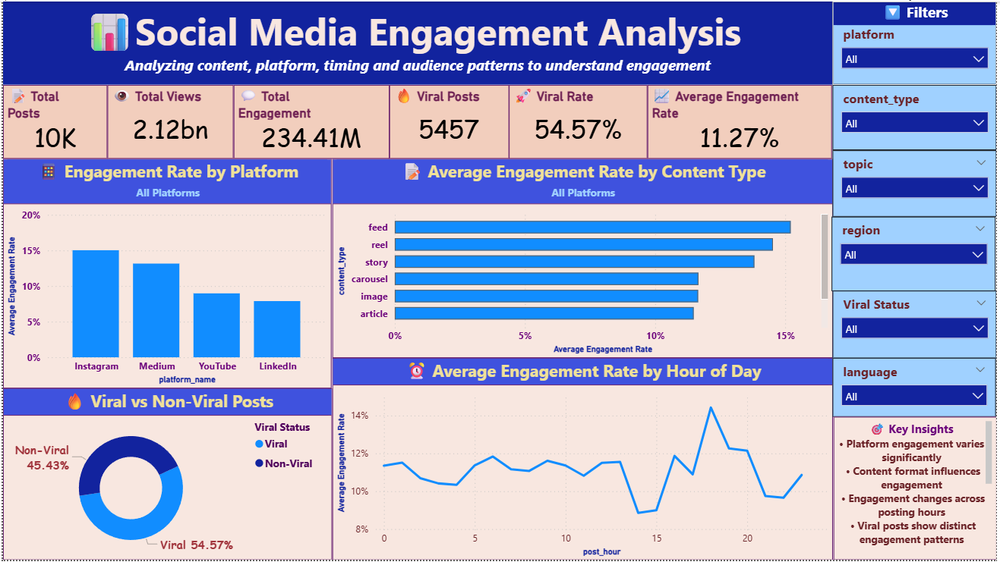

# 📊 Social Media Engagement Analysis | Python, MySQL & Power BI

**Analyzing social media performance to uncover engagement trends, identify high-performing content, and support data-driven content strategies.**

An end-to-end data analytics project using Python, MySQL, SQL, DAX, and Power BI to explore social media engagement across platforms, content types, posting hours, regions, and viral status.

---

## 📌 Project Overview

Social media performance depends on several factors, including the platform, content format, and publishing time. Understanding these patterns can help businesses make informed decisions about their content strategies.

This project transforms social media data into actionable insights through data cleaning, exploratory data analysis, SQL querying, and an interactive Power BI dashboard.

The dashboard provides an overview of key performance indicators (KPIs), compares engagement across platforms and content types, analyzes hourly engagement trends, and explores the distribution of viral and non-viral posts.

## 🎯 Business Problem

Social media managers and digital marketers need to understand which platforms and content formats generate higher engagement and how publishing time relates to audience interaction.

Without a consolidated analytical view, identifying performance patterns and opportunities for improvement can be challenging.

### Project Objectives

- Identify platforms with higher average engagement rates.
- Compare engagement performance across different content types.
- Analyze engagement variations by posting hour.
- Evaluate the proportion of viral and non-viral posts.
- Explore engagement patterns across regions, topics, and languages.
- Build an interactive dashboard that supports data-driven decision-making.

## 🛠️ Tech Stack

| Technology | Purpose |
|---|---|
| Python | Data cleaning, preprocessing, and exploratory data analysis |
| Pandas & NumPy | Data manipulation and transformation |
| Matplotlib & Seaborn | Exploratory data visualization |
| MySQL | Database creation, data storage, and transformation |
| SQL | Data cleaning, aggregations, and analytical queries |
| Power BI | Interactive dashboard development |
| DAX | KPI calculations and analytical measures |
| Git & GitHub | Version control and project documentation |

## 📂 Data Source

**Dataset:** [Social Media Performance and Engagement Data — Kaggle](https://www.kaggle.com/datasets/svthejaswini/social-media-performance-and-engagement-data)

**Format:** CSV

**File used in this project:** `social_media_posts.csv`

The dataset is used to investigate social media performance across platforms and content types, including engagement metrics, publishing time, and viral status.

The data is processed using Python and SQL before being used to develop the Power BI dashboard.

*Note: Dataset characteristics and available columns depend on the original Kaggle files and the preprocessing performed in this project.*

## ✨ Dashboard Features & Highlights

### 1. Key Performance Indicators (KPIs)

The dashboard presents a consolidated view of social media performance through six headline metrics.

| KPI | Dashboard Value |
|---|---:|
| Total Posts | 10K |
| Total Views | 2.12bn |
| Total Engagement | 234.41M |
| Viral Posts | 5,457 |
| Viral Rate | 54.57% |
| Average Engagement Rate | 11.27% |

*Values are taken from the dashboard screenshot and may change when interactive filters are applied.*

### 2. Key Visualizations

**📊 Engagement Rate by Platform**

Compares average engagement rates across Instagram, Medium, YouTube, and LinkedIn to identify differences in platform performance.

**📝 Average Engagement Rate by Content Type**

Compares feed, reel, story, carousel, image, and article content to identify formats with higher observed engagement.

**🔥 Viral vs. Non-Viral Posts**

Uses a doughnut chart to visualize the distribution of viral and non-viral posts and assess the proportion of content classified as viral.

**⏰ Average Engagement Rate by Hour of Day**

Displays hourly engagement variations to identify potential posting windows for further testing.

**🎛️ Interactive Filters**

Allows users to explore dashboard results by:

- Platform
- Content type
- Topic
- Region
- Viral status
- Language

**💡 Key Insights Panel**

Summarizes important engagement patterns to help users interpret the dashboard quickly.

### 3. Key Insights

Based on the displayed dashboard results:

- **Platform performance varies:** Instagram shows the highest average engagement rate among the platforms displayed, at approximately 15%.
- **Content format matters:** Feed and reel content show higher average engagement rates than the other formats shown.
- **Viral posts form a substantial share:** The dashboard reports a viral rate of 54.57%.
- **Engagement varies by posting hour:** The hourly chart shows fluctuations, with a noticeable peak around hour 18.
- **Interactive analysis enables deeper exploration:** Filters make it possible to investigate how engagement patterns differ by topic, region, language, platform, and content type.

These observations describe patterns in the analyzed dataset. They do not establish causation or guarantee that the same results will occur for every social media account.

## 💼 Business Impact

The dashboard demonstrates how data analytics can support social media planning and performance evaluation.

- **Platform optimization:** Helps marketers identify platforms worth investigating for stronger engagement.
- **Content strategy:** Supports comparisons between content formats when planning future posts.
- **Publishing strategy:** Provides hourly engagement patterns that can guide controlled posting-time experiments.
- **Viral content analysis:** Helps evaluate the distribution of viral and non-viral posts.
- **Performance monitoring:** Consolidates important metrics into a single interactive dashboard.
- **Targeted decision-making:** Enables users to investigate engagement patterns across different topics, regions, and languages.

The insights can support better-informed content experiments and resource allocation. Actual business improvements would need to be validated through ongoing performance tracking.

## 📸 Dashboard Preview




## ⚙️ Project Workflow

The project follows an end-to-end data analytics workflow:

1. **Data cleaning with Python:** Prepare the raw dataset for analysis.
2. **Exploratory data analysis:** Investigate engagement metrics, distributions, and trends.
3. **Database development:** Create the MySQL database and data schema.
4. **SQL analysis:** Perform data transformations, aggregations, and analytical queries.
5. **Power BI development:** Connect the data, create DAX measures, and build interactive visualizations.
6. **Insight generation:** Interpret the results and identify potential opportunities for improving social media performance.

## 📁 Project Structure

```text
Social-Media-Engagement-Analysis/
│
├── PowerBI/
│   └── Social_Media_Engagement_Analysis_.pbix
│
├── Python/
│   ├── 01_data_cleaning.py
│   ├── 02_eda.py
│   └── 03_load_mysql.py
│
├── SQL/
│   ├── 01_create_database.sql
│   ├── 02_create_star_schema.sql
│   ├── 03_data_cleaning.sql
│   └── 04_analysis_queries.sql
│
├── Data/
│   └── social_media_posts.csv
│
├── screenshots/
│   ├── dashboard.png
│   ├── Figure_1.png
│   ├── Figure_2.png
│   ├── Figure_3.png
│   ├── icon.png
│   └── model_view.png
│
└── README.md
```

## 🚀 How to Run the Project

### Prerequisites

- Python 3.x
- MySQL Server
- MySQL Workbench or another MySQL client
- Power BI Desktop
- Required Python libraries, including Pandas and NumPy

### Steps

1. Clone or download this repository.
2. Download the dataset from [Kaggle](https://www.kaggle.com/datasets/svthejaswini/social-media-performance-and-engagement-data).
3. Place the required CSV file in the `Data/` directory.
4. Run `Python/01_data_cleaning.py` to clean and preprocess the data.
5. Run `Python/02_eda.py` to perform exploratory data analysis.
6. Execute the SQL scripts in the appropriate order to create the database, prepare the schema, clean the data, and perform analysis.
7. Run `Python/03_load_mysql.py` to load the processed data into MySQL, following the connection and loading requirements of your scripts.
8. Open `PowerBI/Social_Media_Engagement_Analysis_.pbix` in Power BI Desktop.
9. Configure the required data source connection and refresh the data if necessary.
10. Explore the dashboard using the available filters and visualizations.

*Before running the scripts, verify the expected file paths, database credentials, and execution order in your local project.*

## 🔮 Future Improvements

- Add time-based comparisons to track engagement trends over longer periods.
- Introduce additional KPIs and deeper audience segmentation.
- Investigate statistical relationships between content characteristics and engagement.
- Explore machine learning models for engagement or viral-post prediction.
- Automate data refresh and reporting.
- Develop more detailed recommendations using validated performance patterns.

## 📚 Skills Demonstrated

- Data Cleaning and Preprocessing
- Exploratory Data Analysis (EDA)
- Python for Data Analytics
- SQL and MySQL
- Database Design and Data Modeling
- DAX and KPI Development
- Power BI Dashboard Design
- Data Visualization
- Business Intelligence
- Insight Generation and Analytical Storytelling

## ⭐ Conclusion

This project demonstrates an end-to-end data analytics workflow that combines Python, MySQL, SQL, and Power BI to transform social media data into an interactive performance dashboard.

By examining platform engagement, content formats, posting hours, and viral status, the project illustrates how data-driven analysis can help inform social media content planning and performance monitoring.

---

